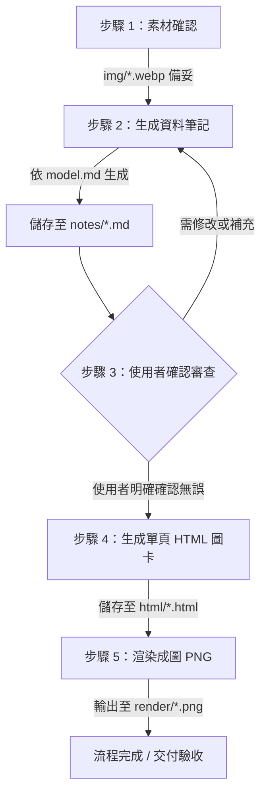

# 《鳴潮》一圖流圖卡生成工作流程規範 (AGENTS.md)

本文件定義自動化生成統一風格、單頁 3:5 比例《鳴潮》角色一圖流圖卡的標準作業流程（Workflow Loop）、目錄結構與執行規範。

---

## 一、專案目標與核心原則

1. **單頁 3:5 比例**：產出之圖卡必須嚴格符合 3:5 縱向比例（建議基準尺寸：`1200px × 2000px`），內容緊湊適中，單頁呈現無滾動條。
2. **純視覺圖檔極簡原則**：
   - **全圖卡唯一允許引用的圖片為角色主視覺圖**。
   - 角色主視覺圖檔為透明背景的 `.webp` 格式，置於 `img/` 目錄。
   - 嚴格禁止引用其他任何外部未授權或裝飾性圖片；其餘所有圖標、屬性徽章、星級、卡片裝飾、幾何邊框等皆必須使用 **純 CSS 與 SVG 向量** 繪製。
3. **資料確認節點（強制規範）**：
   - **在 Markdown 筆記獲得使用者審核確認前，絕對不得執行後續的 HTML 生成與圖卡渲染步驟。**

---

## 二、專案目錄結構

```text
imgGenerate/
├── model.md          # 角色資料標準模板（所有資料欄位以此為基準）
├── template.html     # 統一風格之單頁 3:5 HTML 圖卡標準版型（強制所有角色遵照此結構）
├── AGENTS.md         # 本工作流程與 Agent 指引文件
├── img/              # 角色主視覺透明背景圖檔（.webp）
├── notes/            # 依照 model.md 產生的角色資料筆記（.md）
├── html/             # 3:5 單頁式攻略圖卡原始檔（.html）
└── render/           # 渲染輸出之高解析度圖卡（.png）
```

---

## 三、標準工作流程（Workflow Loop）



### 步驟 1：素材確認 (Asset Preparation)
- 確認目標角色的透明背景 `.webp` 圖檔已存在於 `img/` 目錄（例如：`img/jinhsi.webp`）。
- 辨識角色姓名、英文代號、屬性、武器類型等基礎資訊。

### 步驟 2：生成資料筆記 (Generate Markdown Note)
- 參考專案根目錄的 `model.md` 模板架構。
- 蒐集與整理該角色的完整資料（基本資料、畢業面板、天賦技能優先度、武器與聲骸搭配、推薦配隊、輸出手法、共鳴鏈建議等）。
- 撰寫完成後儲存於 `notes/<角色名稱>.md`。

### 步驟 3：使用者確認審查 (User Confirmation Gate - 關鍵卡點)
- **【核心規則】將 `notes/<角色名稱>.md` 的內容向使用者展示，等待審閱。**
- 聆聽使用者的修正建議（如面板期望、流派偏好、武器配隊選用等）。
- 若有修改，更新 `notes/<角色名稱>.md`。
- **唯有在使用者明確發出「確認」、「通過」或進入下一步的指令後，方可推進至步驟 4。**

### 步驟 4：生成單頁 HTML 圖卡 (HTML Generation)
- 以確認後的 `notes/<角色名稱>.md` 為數據來源。
- 在 `html/` 目錄生成單頁 HTML（例如：`html/<角色名稱>.html`）。
- **樣式與排版規範**：
  - **比例與尺寸**：固定寬高比 3:5（標準視窗寬高 `1200px × 2000px`），設定 `overflow: hidden` 確保無捲軸。
  - **角色圖片引用**：僅引用 `../img/<角色名稱>.webp`。
  - **色彩體系**：以鳴潮深黑科技終端為底（`#0b0d11` ~ `#14181f`），依角色屬性套用對應主題光暈（湮滅/衍射/熔融/氣動/導電/冷凝）。
  - **元件全向量化**：星級、技能標籤、詞條箭頭、分隔線等均以純 CSS/SVG 實現。
  - **三段式佈局**：
    1. 頂部（30-35%）：角色立繪、名稱、屬性/武器/定位、畢業面板參考卡。
    2. 中部（35-40%）：技能升級優先級、武器推薦清單、聲骸搭配與詞條推薦。
    3. 底部（25-30%）：核心配隊推薦、關鍵共鳴鏈效益、連招循環流程圖。

### 步驟 5：渲染輸出 PNG (Render to PNG)
- 使用本機無頭瀏覽器（Microsoft Edge Headless）執行截圖指令（透過 `Start-Process -Wait` 確保截圖完整寫入磁碟）：
  ```powershell
  Start-Process -FilePath "C:\Program Files (x86)\Microsoft\Edge\Application\msedge.exe" -ArgumentList '--headless', '--disable-gpu', '--screenshot="render/<角色名稱>.png"', '--window-size=1200,2000', '"html/<角色名稱>.html"' -Wait
  ```
- 檢查 `render/<角色名稱>.png` 產出品質、確認解析度為精準 `1200px × 2000px` 且無任何捲軸與內容溢出。

---

## 四、Agent 行為準則與檢核清單

每次執行角色圖卡生成任務時，Agent 必須自我檢核以下清單：

- [ ] 是否確認圖片格式為 `.webp` 且存於 `img/`？
- [ ] 是否確保頁面內**絕無**除主視覺外的外部圖片？
- [ ] `notes/<角色名稱>.md` 是否嚴格依循 `model.md` 的資訊架構？
- [ ] **是否已獲得使用者的明確審查通過，才進行 HTML 與 PNG 製作？**
- [ ] **是否嚴格遵循 `template.html` 之統一佈局、字級、模組尺寸與 3:5 結構，僅替換屬性主題色與內容？**
- [ ] HTML 卡片比例是否為精準的 3:5（1200x2000），且文字與內容無溢出或被裁切？
- [ ] 最終產出的 PNG 是否已存入 `render/` 並確認可正常瀏覽？
